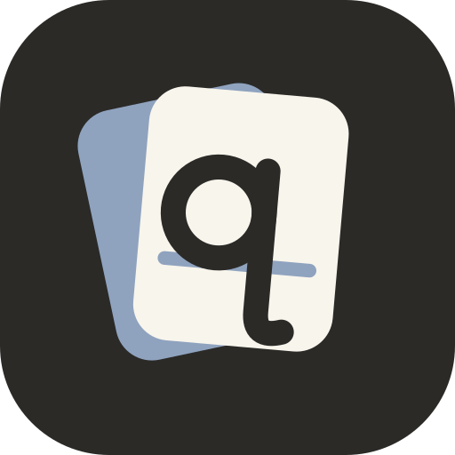

<p align="center"></p>

# Quick Notes

A fast, calm notepad. Open the page and start typing: notes autosave in your browser, with live Markdown (lists, headings, rules, code blocks), three writing fonts, light and dark themes, and export to `.md` or `.txt`. Sign in with email and password to keep your notes in the cloud and sync across devices.

Built with Next.js 16, TypeScript, Tailwind CSS 4, CodeMirror 6, Better Auth, Drizzle ORM and Neon Postgres.

## Setup

Sign-in is **email + password** (Better Auth). There is no email-verification step: signing up logs you straight in and lands on `/dashboard`. Forgot-password sends a reset link by email (Gmail SMTP); a signed-in user can change their password with their current password or by email. Guests can use the app at `/` without signing in; their notes live in the browser and move into the account on first sign-in.

### Local setup

1. Create a Neon project and copy its pooled Postgres connection string. Keep `sslmode=require` in the URL.
2. Install the app and create a local environment file:

   ```sh
   pnpm install
   cp .env.example .env.local
   openssl rand -base64 32
   ```

3. Put the Neon URL in `DATABASE_URL` and the generated random value in `BETTER_AUTH_SECRET`. Keep `BETTER_AUTH_URL=http://localhost:3000` for local development.
4. Apply the checked-in schema migration to the Neon database, then start the app:

   ```sh
   pnpm db:migrate
   pnpm dev
   ```

**Password-reset emails in development:** leave `GMAIL_USER` and `GMAIL_APP_PASSWORD` empty. The reset link is then printed in the terminal running `pnpm dev`; open it to finish the reset. To send real emails through Gmail: turn on 2-Step Verification for the Google account, create an **app password** (Google Account → Security → 2-Step Verification → App passwords), then set `GMAIL_USER` to that Gmail address and `GMAIL_APP_PASSWORD` to the 16-character app password. Gmail limits sending to roughly 500 emails a day, which is plenty for password resets.

### Vercel setup

1. Add `DATABASE_URL` to the Vercel project's environment variables using the Neon pooled connection string.
2. Generate a separate production secret with `openssl rand -base64 32` and set it as `BETTER_AUTH_SECRET`.
3. Set `BETTER_AUTH_URL` to `https://www.quicknotes.site`, the canonical production origin. The apex domain redirects to `www`.
4. Set `NEXT_PUBLIC_SITE_URL` to `https://www.quicknotes.site` as well. Better Auth trusts this exact public origin and the exact Vercel deployment origins.
5. Set `GMAIL_USER` and `GMAIL_APP_PASSWORD` (required in production, since there is no console to print reset links to).
6. Apply pending migrations against the configured Neon database with `pnpm db:migrate` before deploying.

Set these values in Vercel under **Project → Settings → Environment Variables** for Production.

### SEO and answer engines

`NEXT_PUBLIC_SITE_URL` also controls the canonical URLs used by the app. The app then serves:

- `/sitemap.xml` and `/robots.txt` (private routes such as `/dashboard` and `/api` are excluded; AI search crawlers are allowed on public pages)
- `/manifest.webmanifest` with installable app icons
- Open Graph and Twitter share images generated at build time
- JSON-LD structured data (`WebApplication`, `WebSite`, `FAQPage`, `BreadcrumbList`)
- `/about`: features, Markdown shortcuts, keyboard shortcuts and an FAQ written for search and answer engines
- `/llms.txt`: a plain Markdown summary for AI assistants

After deploying, submit the sitemap in Google Search Console and Bing Webmaster Tools.

## Scripts

- `pnpm typecheck` — check TypeScript without emitting files.
- `pnpm lint` — run ESLint.
- `pnpm build` — create a production build.
- `pnpm db:generate` — generate Drizzle migrations.
- `pnpm db:migrate` — apply Drizzle migrations.
- `pnpm db:studio` — open Drizzle Studio.

## License

[MIT](LICENSE)
